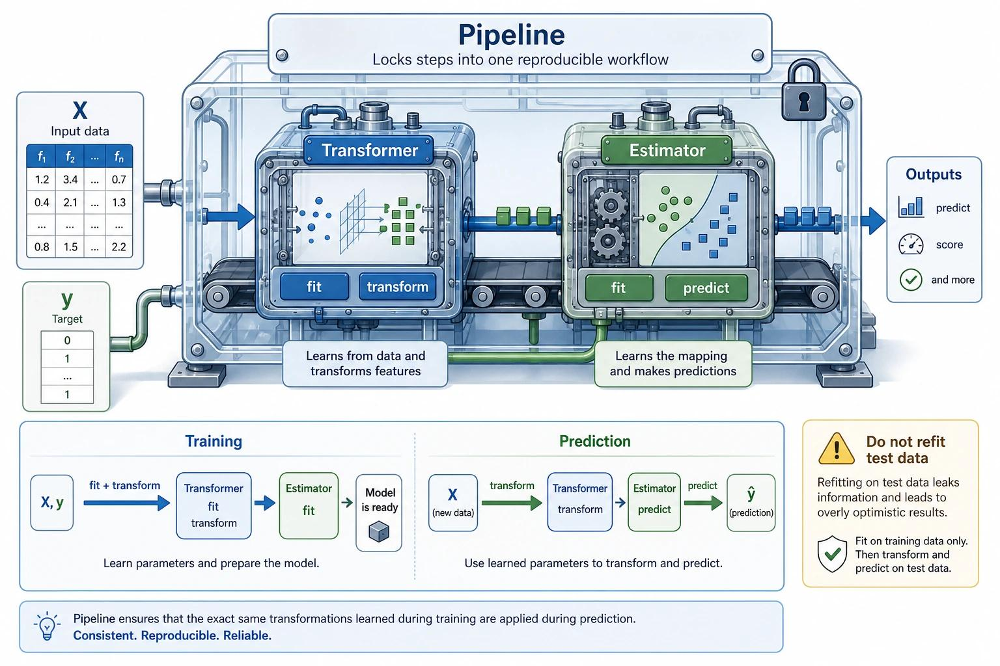

## Scikit-Learn Fundamentals

### What is Scikit-Learn?

*I. Scikit-Learn (also known as sklearn) is a open-source python library for machine learning that provides tools to build, train, evaluate and optimize machine learning models.* 
*II. In simple word, Scikit-Learn makes easy to implement machine learning algorithms without writting every algorithm from scratch.* 

It provides ready-to-use implementation of algorithm such as:

*I. Linear Regression* 
*II. Logistic Regression* 
*III. Descision Trees* 
*IV. Random Forest* 
*VI. Support Vector Machines (SVM)* 
*VII. K-Nearest Neighbours (KNN)* 
*IX. K-Means Clustering* 
*X. Naive Bayes* 
*XI. Principal Component Analysis (PCA)*

### What we can do with Scikit-Learn?

Scikit-Learn provides tools for almost every traditional machine learning workflows.

For example:

#### I. Data Processing
*Clean, transform, Scale and Prepare dataset before training the model.*

#### II. Model Training
*Train regression, classification and clustering algorithm.*

#### III. Model Evaluation
*Evaluate performance using accuracy, precision recall, F1-score, MSE, and other metrices.*

#### IV. Model Oprimization
*Improve model performance using Cross-Validation, Grid Search and Randomized Search.*

#### V. Machine Learning Pipelines
*Combine preprocessing and model training into a reusable workflow.*

### What Scikit-Learn is not designed for?

Scikit-Learn is primarly designed for traditional machine learning, not deep learning.

--figure here

### Scikit-Learn architecture Features

*I. Scikit-Learn architecture referes to how it's different components are organized and how they work together to perform a machine learning tasks.* 
*II. The architecture is build around a common interface called the Estimator API (Application Programming Interface).* 
*III. The Estimator API provides a consistent way to create, train, transform and evaluate machine learning models.* 

For example, whether you use Linear Regression, Logistic Regression or Random Forest, the basic workflow remains almost same.

**Important Notes:**

*I. Piplines ensures that the exact same transformation learned during training are applied during prediction* 

*II. Do not refit test data, refiting on test data leaks information and leads to overly optimistic results.* 

*III. fit on training data only. then transform and predict on test data.*

### Major Components of Scikit-Learn

Scikit-Learn has several important components:

#### 1. Estimators
*Train machine learning models*

#### 2. Transformers
*Transform or preprocess data*

#### 3. Predictors
*Make Predictions*

#### 4. Model Selection
*Split data and select/tune models.*

#### 5. Metrices
*Evaluate multiple ML steps.*

#### 6. Pipelines
*Combine multiple ML steps.*

#### 7. Datasets
*Loads sample datasets.*

