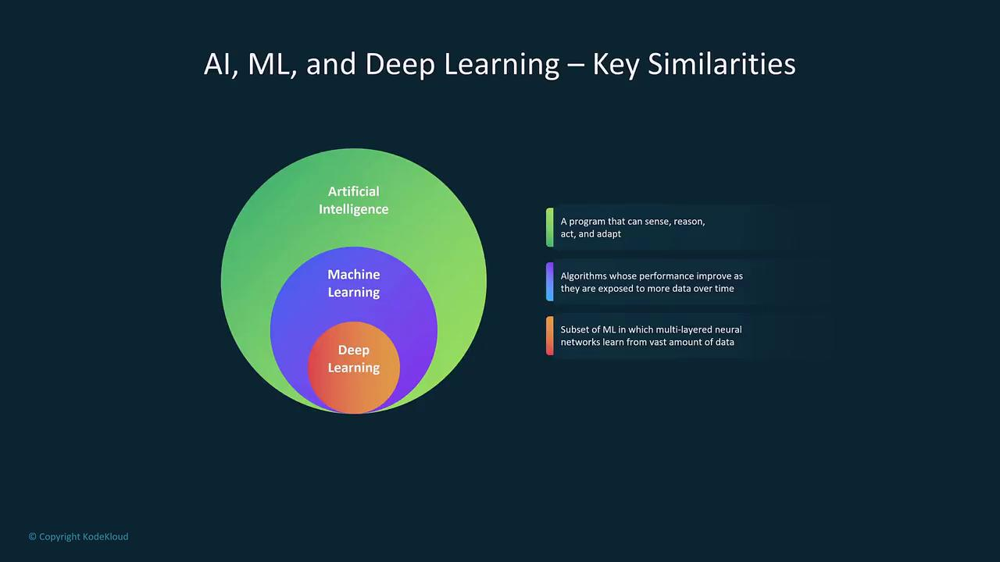
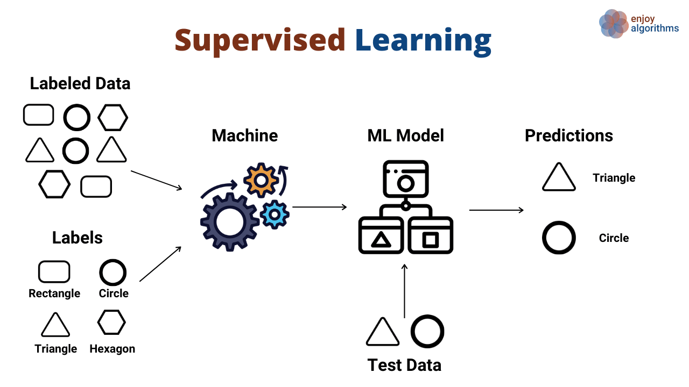
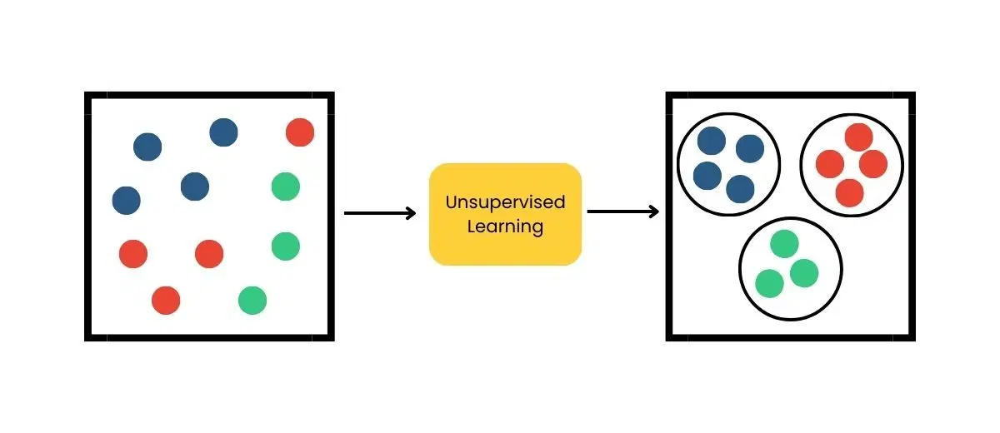
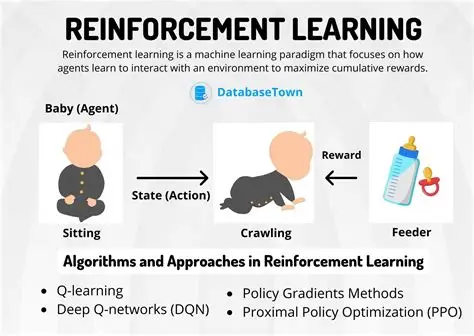

## Introduction to Machine Learning

### Artificial intelligence (AI)

Artificial intelligence refers to computer system or machines designed to simulate human intelligence processes. These processes include recognizing patterns, understanding languange, making decisions, solving problems, and learning from experience.

Unlike traditional software that follows fixed instructions, AI system can improve their performance by analyzing large amounts of data and identifying patterns, allowing them to adapt to new situations.

### What is Machine Learning?

Machine learning is a subset of artificial intelligence that enables computers to learn patterns from data and make predictions or decisions without being explictly programmed.

### What is a Model?

A machine learning model is a computational program that learns relationships from data and uses them to perform tasks such as prediction, classification, or pattern detection. It encapsulates the knowledge extracted during training and generalizes it to new, unseen data.

### Types of ML systems

ML can be categories in the following categories based on how they learn to make predictions and generate content.

I. Supervised Learning 
II. Unsupervised Learning 
III. Reinforcement Learning

#### I. Supervised Learning

Supervised Learning models can make predictions after seeing a lot of data with the correct output and then discovering the connection between the element in the data that produces the correct output.

Supervised Learning models are further classified into two types:

I. Regression 
II. Classification

##### I. Regression

A regression model predicts numerical values. For example, a whether model that predicts the amount of rain in inches or milimeters, is a regression model.

More examples of regression models are:
- Future house price
- Future ride price

##### II. Classification

Classification models predicts the liklihood that something belongs to a categories. unlike, regression models, whose output is a number, classification models output a value that states whether or not something belongs to a particular category.

For example, classification models are used to predict if an email is spam or if a photo contains a cat.

Classification models are further divided into two groups:

- **Binary Classification:** models output a vaue from a class that contains two values. For example, a model that output either rain or norain.

- **Multiclass Classification:** models output a value from a class that contains more than two values. For example, a model that can output either rain, hail, snow or sleet.

#### II. Unsupervised Learning

Unsupervised learning is a machine-learning approach where algorithm learn patterns directly from unlabeled data.

An unsupervised learning model aims to identify meaningful patterns in a dataset. For example, many unsupervised learning models rely on a technique called clustering to organize simillar data into groups called 'clusters'.

Clustering differs from Classification because the categories aren't defined by you. For example, an unsupervised model might cluster a whether dataset based on temperature, revealing segmentaiton that define the seasons. You might then attempt to name those clusters based on your understanding of the dataset.

#### What distingushes a supervised approach from an unsupervised approach?

A supervised approach is given data that contains the correct answer. The models job is to find connections in the data that produce the correct answer. An unsupervised approach is given data without the correct answer, its job is to find grouping in the data.

#### III. Reinforcement Learning

Reinforcement learning models make predictions by getting rewards or penalties based on actions performed within an environment. A reinforcement learning systems generates a policy that defines the best strategy for getting the most rewards.

Reinforcement learning is used to train robots to perform tasks like walking around a room, and software programs like AlphaGo to play the game of Go.

**Key Terms:**
- Model
- clustering
- Policy
- Prediction
- Supervised Learning
- Regression model
- Classification model
- Binary classification
- Multicalss classfication
- Unsupervised Learning
- Reinforcement Learning