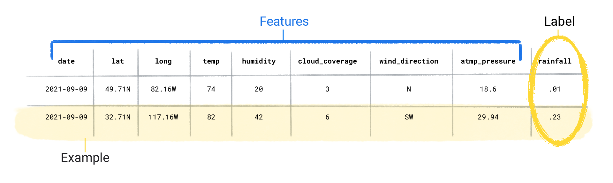

### Supervised Learing

Supervised learning is a type of a machile learning where the model learns from the data that already contains the correct answer.

The word supervised means someone is supervising or guiding the learning by providing the correct answers.

### Foundational Supervised Learning concepts

Supervised machine learning is based on the following core concepts:
- Data
- Model
- Training
- Evaluating
- Inference

#### Data

In machine learning, data refers to the set of observations, measurements, or records used to train, validate, and test algorithms so they can lern patterns and make predictions. Without data, machine learning models cannot be trained or evaluated.

Data is the driving force of machine learning. Data comes in the form of words and numbers stored in tables, or as the value of pixels and waveforms captured in images and audio files. We store related data in datasets. For example, we might have a dataset of the following:
- Images of cats
- Housing prices
- Weather information

Datasets contains **features** and a **label**.

'features' are the values that a supervised model uses to predict the label.

The 'label' is the 'answer' or the value that we want the model to predict.

In a weather model that predict rainfall, the features could be latitude, longitude, temperature, atmospheric pressure. The label would be rainfall amount.

Examples that contains both features and label are called labeled data.

##### Dataset characterstics

A dataset is characterized by its size and diversity.

Size indicates the number of examples.

Diversity indicates the range those examples cover.

Good datasets are both large and highly diverse.

#### Model

In supervised learning, a model is the complex collection of numbers that define the mathmatical relationship from specific input features patterns to specific output label values. The models discovers these patterns through training.

#### Training

Before the model can make predictions, it must be trained. To train a model, we give the model a dataset with labeled examples. The model's goal is to workout the best solution for predicting the labels from features.

The model finds the best solution by compairing the predicted values with the labels actual values.

Based on the difference between the predicted and actual values called **loss**, the model gradually updates its solution.

During training, Ml practitioners can make subtle adjustments to the configurations and features the model uses to make predictions. For example certain feature have more predictive power that others. Therefor, ML practitioner can select which features the model uses during training.

#### Evaluating

We evaluate a trained model to determine how well it learned. When we evaluate a model, we use a labeled dataset, but we only give  the model the dataset's features. We then compare the model's predictions to the label's true values.

Depending on the model's predictions, we might do more training and evaluating before deploying the model in a real-world application.

#### Inference

Once we're satisfied with the results from evaluating the model, we can use the model to make predictions, called inference on unlabeled data.

Inference is the deployment phase of a machine learning model. Inference refers to using your well trained model in real-time application on unseen data.

**Key terms:**
- feature
- label
- labeled data
- loss
- training
- inference
- evaluate
- datasets
- data