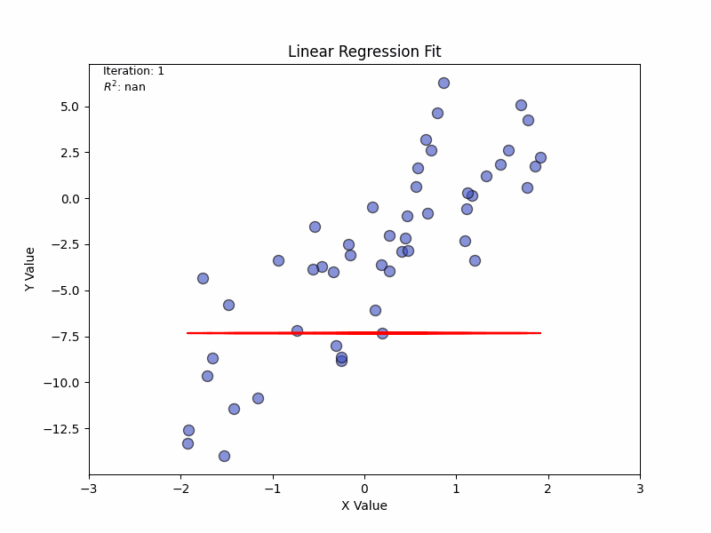
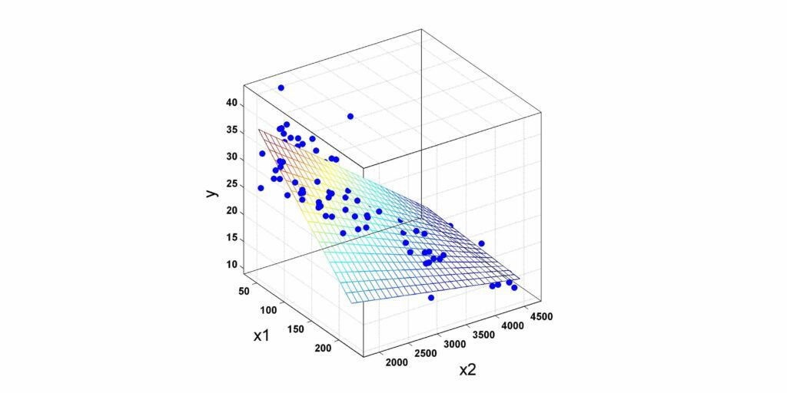

### Linear Regression

Linear regression is a supervised machine learning algorithm that models the relationship between input features(independent variables) and a continous output(dependent variable) by fitting the best-fit straight line using the methods like gradient descent or Ordinary least squares(OLS), adjusting 'weights'(coefficients) and 'bias'(intercept) to minimize prediction error.



It assumes a linear relationship between features and label.

<hr>

### Linear Regression Equation

In algebraic terms, the model would be defined as ```y = mx + c``` where:
- y is the value we want to predict.
- m is the slope of the line.
- x is the input value.
- b is the y-intercep.

In ML, we write the equation for a linear regression model as follows:

```y' = b + w1x1```

Where:
- y' is the predicted label (the output) also known as the dependent variable(s).
- b is the bias of the model. Bias is same as the y-intercept in the algebraic equation for a line. In ML, bias is sometimes referred as w0. Bias is the parameter of the model and is calculated during training.
- w1 is the weight of the feature, weight is same the concept as the slope m in the algebraic equation for a line. Weight is the parameter of the model and calculated during training.
- x1 is the feature (the input) also known as the independent variable(s).

During training, the model calculates weight and bias that produce the best model.

For multiple independent variables, we can write linear regression equation as:

```y' = b + w1x1 + w2x2 + w3x3 + ... + wnxn```



The diagram containing only 2 independent variable. diagram can be so much complex or impossible to imagine if there is more numbers of independent variables present.


**Goal:** Minimize the difference between actual and predicted values (residuals).

**Optimization:** Typically done using 'least squares' or 'gradient descent'.

<hr>

### Types of Linear Regression

#### 1. Simple Linear Regression

Models the relationship between one feature and one target using a straight line.

- **Advantage:** Easy to interpret.
- **Limitation:** Cannot capture non-linear patterns.

#### 2. Multiple Linear Regression

Uses multiple features to predict the target.

- **Advantage:** captures combined effects of many variables.
- **Limitation:** Sensitive to multicollinearity.

#### 3. Polynomial Regression

Transforms features into polynomial terms to model curved relationships while remaining linear in parameters.

- **Advantage:** Captures non-linear trends.
- **Limitation:** High-degree polynomials may overfit.

#### 4. Regularized Linear Regression

Includes **Ridge (L2)** and **Lasso (L1)** regression.

- **Purpose:** Reduce overfitting by penalizing large coefficients.
- **Lasso:** Can shrink some coefficients to zero (feature selection).

<hr>

**Key terms:**
- Bias
- Feature
- Label
- Linear regression
- Parameter
- Weight