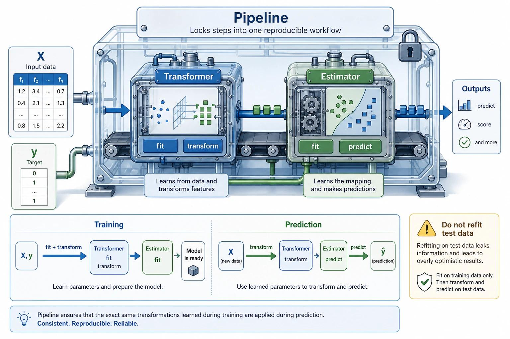

## Scikit-Learn Fundamentals

### What is Scikit-Learn?

*I. Scikit-Learn (also known as sklearn) is a open-source python library for machine learning that provides tools to build, train, evaluate and optimize machine learning models.*<br>
*II. In simple word, Scikit-Learn makes easy to implement machine learning algorithms without writting every algorithm from scratch.*<br>

It provides ready-to-use implementation of algorithm such as:

*I. Linear Regression*<br>
*II. Logistic Regression*<br>
*III. Descision Trees*<br>
*IV. Random Forest*<br>
*VI. Support Vector Machines (SVM)*<br>
*VII. K-Nearest Neighbours (KNN)*<br>
*IX. K-Means Clustering*<br>
*X. Naive Bayes*<br>
*XI. Principal Component Analysis (PCA)*

<hr>

### What we can do with Scikit-Learn?

Scikit-Learn provides tools for almost every traditional machine learning workflows.

For example:

#### I. Data Processing<br>
*Clean, transform, Scale and Prepare dataset before training the model.*

#### II. Model Training<br>
*Train regression, classification and clustering algorithm.*

#### III. Model Evaluation
*Evaluate performance using accuracy, precision recall, F1-score, MSE, and other metrices.*

#### IV. Model Oprimization
*Improve model performance using Cross-Validation, Grid Search and Randomized Search.*

#### V. Machine Learning Pipelines
*Combine preprocessing and model training into a reusable workflow.*

<hr>

### What Scikit-Learn is not designed for?

Scikit-Learn is primarly designed for traditional machine learning, not deep learning.

--figure here

<hr>

### Scikit-Learn architecture Features

*I. Scikit-Learn architecture referes to how it's different components are organized and how they work together to perform a machine learning tasks.*<br>
*II. The architecture is build around a common interface called the Estimator API (Application Programming Interface).*<br>
*III. The Estimator API provides a consistent way to create, train, transform and evaluate machine learning models.*<br>

For example, whether you use Linear Regression, Logistic Regression or Random Forest, the basic workflow remains almost same.



**Important Notes:**

*I. Piplines ensures that the exact same transformation learned during training are applied during prediction*<br>

*II. Do not refit test data, refiting on test data leaks information and leads to overly optimistic results.*<br>

*III. fit on training data only. then transform and predict on test data.*

<hr>

### Major Components of Scikit-Learn

Scikit-Learn has several important components:

#### 1. Estimators:

*I. An Estimator is an object that learn from data.*<br>
*II. In simple words, an Estimator is an object that provides a ```fit()``` method to learn patterns or parameters from training data.*<br>

For example:

```
from sklearn.linear_model import LinearRegression

model = LinearRegression()

model.fit(X_train, Y_train)
```

Here,<br>
*LinearRegression is the estimator class.*<br>
*model is an estimator object (an instance of that class)*<br>
*The ```fit()``` methods learns model parameters from the training data.*

**Important:** Estimators are not limited to predictive models, preprocessing object, such as StandardScalar, are also an estimators.


#### 2. Transformers

*I. A Transfromer is an object that learns how to transform data and then applies that transformation.*

It generally provide two important method:

*1. ```fit()``` - learns the required transformation parameters.*<br>
*2. ```transform()``` - applies the learned transformation to data.*

For example:

```
from sklearn.preprocessing import StandardScalar

Scaler = StandardSaclar()

x = [[1000], [2000], [3000], [4000]]

# learn mean and standard deviation
Scaler.fit(x)

x_scaled = Scaler.transform(x)

print(x_scaled)
```

here,<br>
*```fit()``` - calculates the mean and standard deviation of the traning data.*<br>
*```transform()``` - uses those learned values to standardize the data.*

You can also combine both operation using:
```x_scaled = Scaler.fit_transform(x)```

**Important:** ```fit_transform()``` is a convenient combination of ```fit()``` and ```transform()```. It is commonly used for training data preprocessing.


